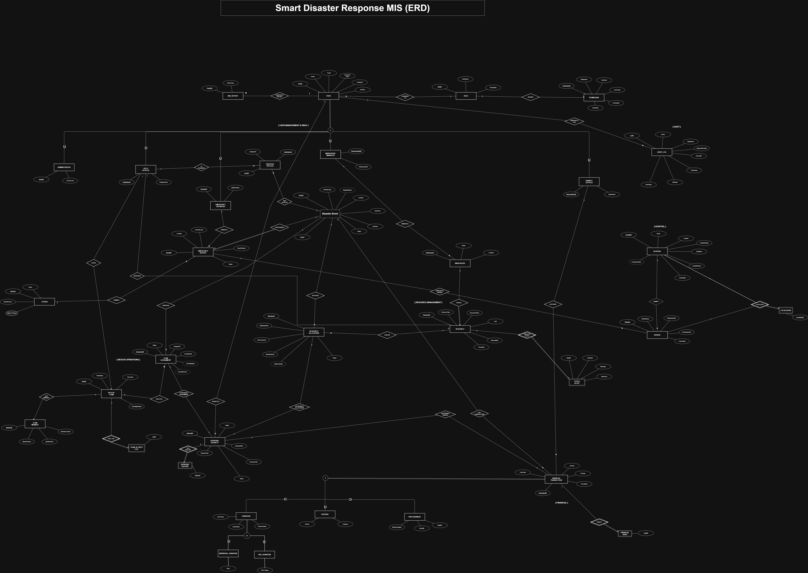
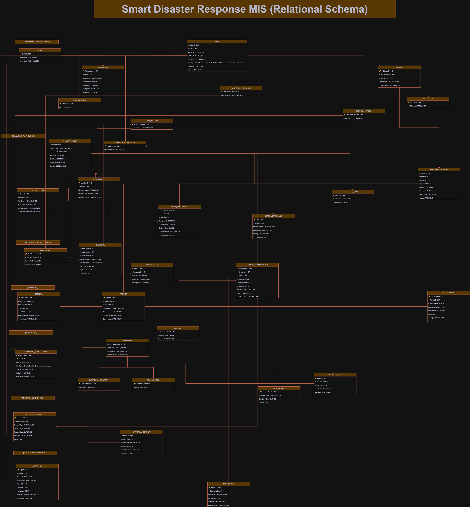

# 🚨 DISMIS — Disaster Management Information System

A centralized, scalable system built to coordinate emergency responses, manage medical capacities, track critical resources, and handle complex financial flows across a disaster-stricken region. 

> **Important**: This project has been updated to fully align with the relational design phase, including all 3NF schema tables, disjoint subtypes, views, and triggers.

---

## 🛠️ Technology Stack
- **Database**: Microsoft SQL Server (SSMS)
- **Backend**: Node.js, Express.js
- **Frontend**: Vanilla JavaScript, HTML, CSS (Dark-Ops Glassmorphism UI)
- **Authentication**: JWT (JSON Web Tokens) with Role-Based Access Control (RBAC)

---

## 🚀 How to Run Locally

### 1. Database Setup (SSMS)
This application uses a local SQL Server instance. 

1. Open **SQL Server Management Studio (SSMS)**.
2. Ensure you have an active local server connection.
3. Open `database/schema.sql` and run it to create the `disaster_mis` database and seed the initial roles.

### 2. Backend Configuration
1. Open the `backend` folder.
2. Open the `.env` file and update your SSMS credentials:
   ```env
   DB_SERVER=localhost
   DB_PORT=1433
   DB_DATABASE=disaster_mis
   DB_USER=sa
   DB_PASSWORD=your_local_password
   DB_ENCRYPT=false
   DB_TRUST_SERVER_CERT=true
   ```
   *(If using Windows Authentication, you will need to add `msnodesqlv8` package and use an integrated connection string instead).*
3. Install dependencies and start the server:
   ```bash
   cd backend
   npm install
   npm start
   ```

### 3. Accessing the Application
Once the backend is running, the frontend is automatically served at:
👉 **http://localhost:5000**

You can also run the frontend using **VS Code Live Server**. It is configured to automatically point to the backend running on port `5000`.

### 🔑 Demo Login Accounts
All seeded accounts share the default password: **`Admin@123`**

| Role | Email | Password |
| :--- | :--- | :--- |
| **Administrator** | `admin@dismis.pk` | `Admin@123` |
| **Emergency Operator** | `operator@dismis.pk` | `Admin@123` |
| **Field Officer** | `field01@dismis.pk` | `Admin@123` |
| **Warehouse Manager** | `warehouse@dismis.pk` | `Admin@123` |
| **Finance Officer** | `finance@dismis.pk` | `Admin@123` |

---

## 📐 System Design & Architecture

### Entity-Relationship Diagram (ERD)


### Relational Schema (3NF)


---

## 📂 Core Modules
1. **User Management:** Complete Disjoint sub-types (Admin, Emergency Operator, Field Officer, Warehouse Manager, Finance Officer) with dedicated privileges.
2. **Emergency Response:** Real-time logging of disaster events, citizen tracking, severity evaluation, and intelligent rescue team assignment (`sp_AssignRescueTeam`).
3. **Medical Escalation:** Dynamic tracking of hospital beds and patient admission workflows. Includes an automated trigger to deduct available beds upon admission.
4. **Resource Logistics:** Tracks warehouse inventory with critical stock alerts. Includes resource requests, approval cycles, and allocation triggers.
5. **Financial Operations:** Logs donations, emergency expenses, and procurements with strict financial auditing.

## 📈 Performance & Integrity
- Designed using **3rd Normal Form (3NF)**.
- Implements **Disjoint Subtyping** logic for both Users and Transactions.
- Utilizes **Triggers** for automated tracking (Stock alerts, bed occupancy, audit logging).
- Includes **Stored Procedures** with robust `TRY...CATCH` transaction handling to enforce data atomicity.

---

## 📄 Documentation & Project Statement
- [Final Project Report (PDF)](docs/Final_Project_Report.pdf)
- [Database Project Statement & Requirements (PDF)](docs/Project_Description.pdf)

---
**Made for the Database Project final delivery.**

